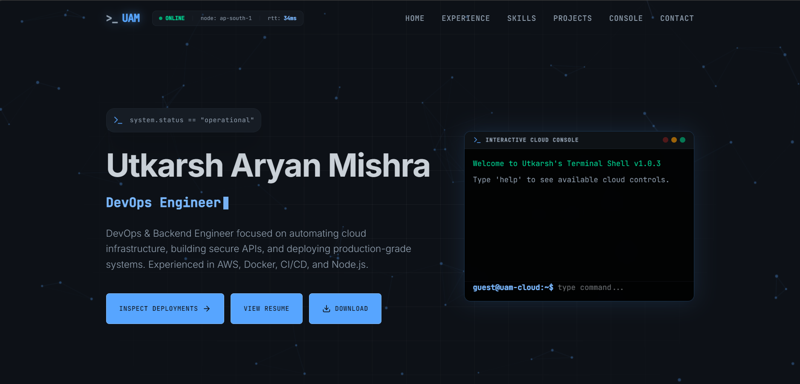

# 🌐 DevOps Portfolio Website (React + TypeScript + AWS EC2 + Docker + Terraform + CI/CD)

<p align="center">
  
  
  
  
  
  
  
</p>

---

## 📌 Overview

This project is a **modern DevOps portfolio website** built using **React and TypeScript**, containerized with **Docker & Nginx**, provisioned on an **AWS EC2 instance (Amazon Linux 2023)** using **Terraform**, secured with **Certbot SSL/TLS**, and fully automated with a **GitHub Actions SSH CI/CD pipeline**.

It demonstrates end-to-end **Cloud Infrastructure Engineering + Modern DevOps Practices**, including Infrastructure as Code, container orchestration, single-page app (SPA) web server configuration, custom DNS mapping, and zero-downtime deployment pipelines.

---

## 🌐 Live Demo

👉 **https://utkarsh-portfolio.duckdns.org**

---

## 🖼️ Showcase



---

## 🏗️ Architecture

```
User Browser 
    │ (HTTPS / Port 443)
    ▼
Custom DNS (utkarsh-portfolio.duckdns.org) ➔ Elastic IP (13.200.118.170)
    │
    ▼
AWS EC2 Instance (Amazon Linux 2023)
    │
    ├── Nginx Container (Docker) ➔ SPA Fallback & Gzip Compression
    ├── Let's Encrypt SSL/TLS ➔ Automatic HTTP to HTTPS 301 Redirect
    └── Docker Engine
            ▲
            │ (Automated SSH & Container Deployment)
    GitHub Actions CI/CD (Pushes to `main` branch)
            ▲
    Terraform (IaC - EC2, EIP, Security Group Provisioning)
```

---

## ⚙️ Tech Stack

### 🔹 Frontend & UI
* **React 18** with **TypeScript**
* **Vite** (Next-generation frontend toolchain)
* **Lucide Icons** & **Tailwind CSS**

### 🔹 Infrastructure & DevOps
* **AWS EC2** (Amazon Linux 2023, Elastic IP, Security Groups)
* **Docker & Docker Compose** (Containerization & process isolation)
* **Nginx** (High-performance web server & reverse proxy)
* **Terraform** (Infrastructure as Code for provisioning AWS resources)
* **Certbot / Let's Encrypt** (Automated free SSL/TLS certificates)
* **GitHub Actions** (Automated CI/CD deployment via SSH & SCP)

---

## 📂 Project Structure

```
portfolio_v2/
│── .github/
│    └── workflows/
│         └── deploy.yml      # CI/CD Pipeline for EC2 Deployment
│── terraform/
│    ├── main.tf              # EC2, Security Group & Elastic IP
│    ├── provider.tf          # AWS Provider Config
│    ├── variables.tf         # Configurable Variables
│    ├── outputs.tf           # Terraform Outputs (Public IP, SSH)
│    └── user_data.sh         # EC2 Bootstrap Script
│── Dockerfile                # Multi-stage Docker Build (Node 20 -> Nginx)
│── nginx.conf                # Nginx Config (SPA fallback, Gzip, SSL)
│── docker-compose.yml        # Docker Compose Orchestration
│── public/
│── src/
│    ├── components/
│    ├── hooks/
│    ├── pages/
│    ├── App.tsx
│    └── main.tsx
│── package.json
│── vite.config.ts
└── README.md
```

---

## 🔄 CI/CD Workflow

1. Developer pushes code changes to the `main` branch on GitHub.
2. **GitHub Actions** workflow triggers automatically.
3. Node.js environment builds production static bundle using `npm run build`.
4. Artifacts and server configurations (`dist`, `nginx.conf`, `Dockerfile`) are uploaded to EC2 via **SCP**.
5. Remote SSH commands rebuild and launch the **Docker container** (`portfolio-v2`) with mounted SSL certificates on ports `80` & `443`.

---

## 🛠️ Infrastructure Setup with Terraform

To provision or reproduce the cloud infrastructure:

```bash
cd terraform
terraform init
terraform plan
terraform apply
```

---

## 🔐 Production SSL & SPA Routing Solutions

### 1. SPA Routing Fallback
Single-page apps using client-side routing require all non-static file requests to serve `index.html`. Configured in `nginx.conf`:
```nginx
location / {
    try_files $uri $uri/ /index.html;
}
```

### 2. Automated HTTPS Redirection
Configured Let's Encrypt SSL/TLS using Certbot and set up HTTP to HTTPS 301 redirection:
```nginx
server {
    listen 80;
    server_name utkarsh-portfolio.duckdns.org;
    return 301 https://$host$request_uri;
}
```

---

## 📊 Key Highlights & DevOps Skills Demonstrated

✔ **Infrastructure as Code (IaC)** with Terraform  
✔ **Containerization** with Docker & Nginx  
✔ **Cloud Compute** with AWS EC2 & Elastic IPs  
✔ **Web Security** with Let's Encrypt SSL/TLS & Security Groups  
✔ **CI/CD Automation** with GitHub Actions & SSH  
✔ **SPA Routing & Performance Optimization** with Gzip & Cache Control  

---

## 🤝 Connect with Me

* **Portfolio**: [utkarsh-portfolio.duckdns.org](https://utkarsh-portfolio.duckdns.org)
* **LinkedIn**: [linkedin.com/in/utkarsh090205](https://www.linkedin.com/in/utkarsh090205/)
* **GitHub**: [github.com/PandaVerse09](https://github.com/PandaVerse09)

---

⭐ **Star this repository if you found it helpful!**
